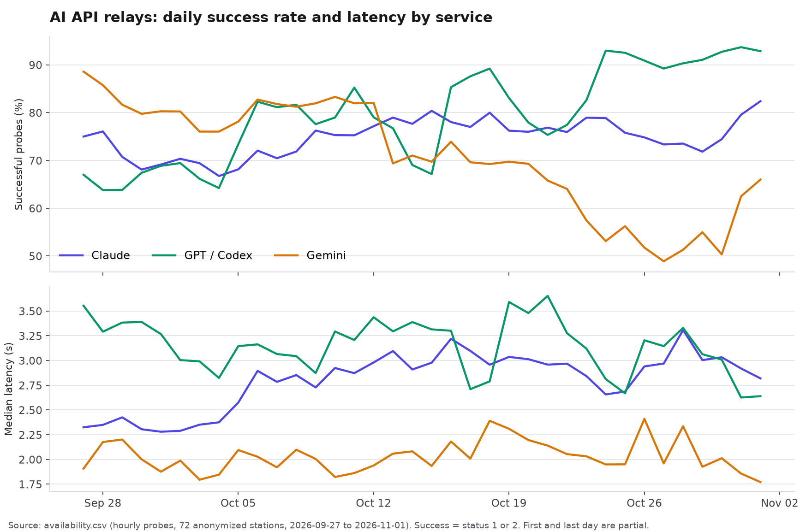

# AI API Relay Availability and Authenticity

Data licensed CC BY 4.0. `chart.py` is MIT. Also on Hugging Face: [axiegameboy/ai-api-relay-monitoring](https://huggingface.co/datasets/axiegameboy/ai-api-relay-monitoring) (same files).

Anonymized monitoring data from [OkkMax](https://www.okkmax.com), a review site for third-party AI API relays (resellers that forward requests to Claude, GPT and Gemini). Two tables:

- **availability** : hourly probe results (status, latency, availability) per relay channel, 2026-09-27 to 2026-11-01.
- **detection** : authenticity checks that ask whether a channel really serves the model it advertises, 2026-07-04 to 2026-11-01.

Station and channel identifiers are salted hashes. Names, domains, base URLs, API keys and response bodies are not included.



*Daily share of successful probes (`status` 1 or 2) and median latency of those probes, by service, across all stations in `availability.csv`.*

## availability.csv

190,197 rows, 72 stations, 350 channels.

| column | meaning |
|---|---|
| `station_id` | salted hash of the station (10 hex chars), stable across both files |
| `channel_id` | salted hash of the channel (a station can have several channels, one per group) |
| `service` | `cc` Claude, `cx` GPT / Codex, `gm` Gemini |
| `probed_hour_utc` | probe time, rounded down to the hour (UTC) |
| `status` | `1` healthy, `2` degraded (slow, still counted as available), `0` failed |
| `latency_ms` | end-to-end latency of the probe request in milliseconds (0 for some failed probes) |
| `availability` | availability percentage reported by the prober for that reading, empty if unknown |

Notes: probing is roughly hourly, but some channels were probed twice within an hour, so 1,332 `(channel_id, probed_hour_utc)` pairs repeat. Keep, average or drop them as suits your analysis.

## detection.csv

8,107 rows, 76 stations, 370 channels.

| column | meaning |
|---|---|
| `station_id`, `channel_id`, `service` | same as above |
| `detected_hour_utc` | check time, rounded down to the hour (UTC) |
| `model` | model the channel was asked to serve |
| `actual_model` | model name the upstream reported, empty if it did not report one |
| `model_downgraded` | `t` if the checker flagged that the upstream answered with a lower model than requested, `f` if not, empty if the upstream reported no model |
| `total_score` | overall authenticity score, 0 to 100 |
| `verdict` | `passed`, `marginal` or `failed` |
| `tier` | `pureblood` (served by the official backend, either the official API or a reverse-proxied official web account), `downgrade` (labelled as a premium model but actually routed through a different channel such as AWS Bedrock or Kiro), `counterfeit` (a cheaper, different model passed off as the advertised one) |
| `protocol` | `anthropic`, `openai` or `gemini` |

## Collection

Availability comes from a continuously running prober that sends a real request to each monitored channel. Authenticity checks send a fixed set of probes and compare fields, protocol behavior and cryptographic signatures against official baselines. Scoring rules are public at [okkmax.com/help](https://www.okkmax.com/help#scoring). A small open-source benchmark for TTFT and prompt-cache behavior is at [Okkmass/api-bench](https://github.com/Okkmass/api-bench).

## Limitations

- **Selection bias.** Only relays listed on OkkMax are covered, and the probe model and prompt template differ by channel.
- **Not fully unlinkable.** The same per-station numbers are shown publicly on okkmax.com, so a determined reader could match time series back to a station. Please do not try to re-identify stations or publish such a mapping.
- Probes reflect our network vantage point and one request per reading. A single failed reading does not mean the station was down for the whole hour.
- Scores and tiers are measurements at a moment in time, not a judgment of a business.

## Citation

```
@dataset{okkmax_relay_2026,
  title  = {AI API Relay Availability and Authenticity},
  author = {OkkMax},
  year   = {2026},
  url    = {https://www.okkmax.com}
}
```

---

## 中文说明

数据来自 [OkkMax](https://www.okkmax.com) 对第三方 AI API 中转站的持续监测，已匿名化。

- `availability.csv`：每小时一次的探测结果（状态、延迟、可用率），2026-09-27 至 2026-11-01，共 190,197 行。
- `detection.csv`：真伪检测结果（是否真的提供所宣称的模型），2026-07-04 至 2026-11-01，共 8,107 行。

站点和渠道 ID 都是加盐哈希，不含站名、域名、地址、密钥和响应原文。`status` 的含义：1 正常，2 降级（偏慢但计入可用），0 失败。`tier` 的含义：`pureblood` 官方纯血，`downgrade` 以次充好，`counterfeit` 顶包。

数据只覆盖 OkkMax 收录的站点，存在选择偏差。同样的数据在 okkmax.com 上按站公开展示，因此并非完全不可关联，请勿尝试还原站点身份或公布对应关系。
